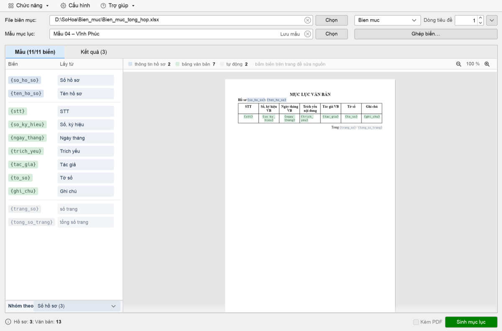
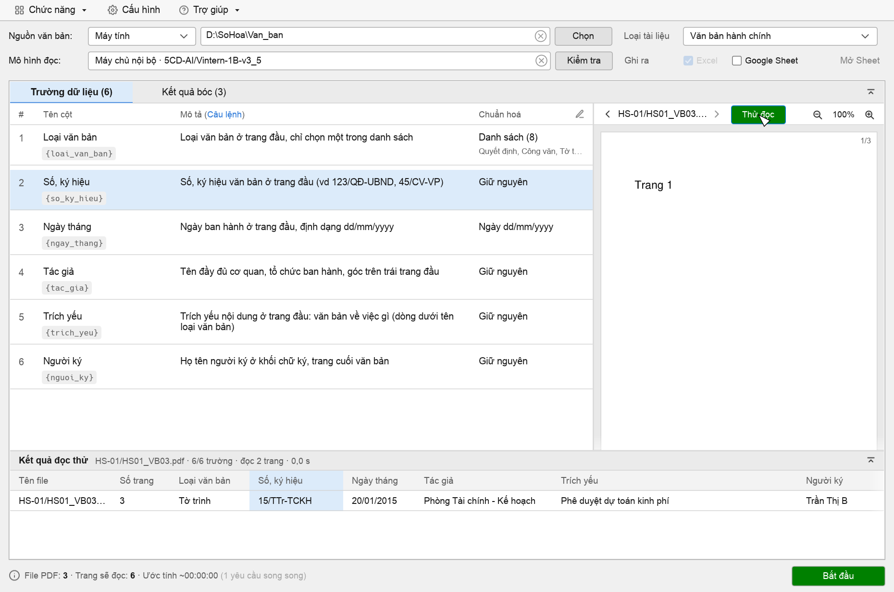
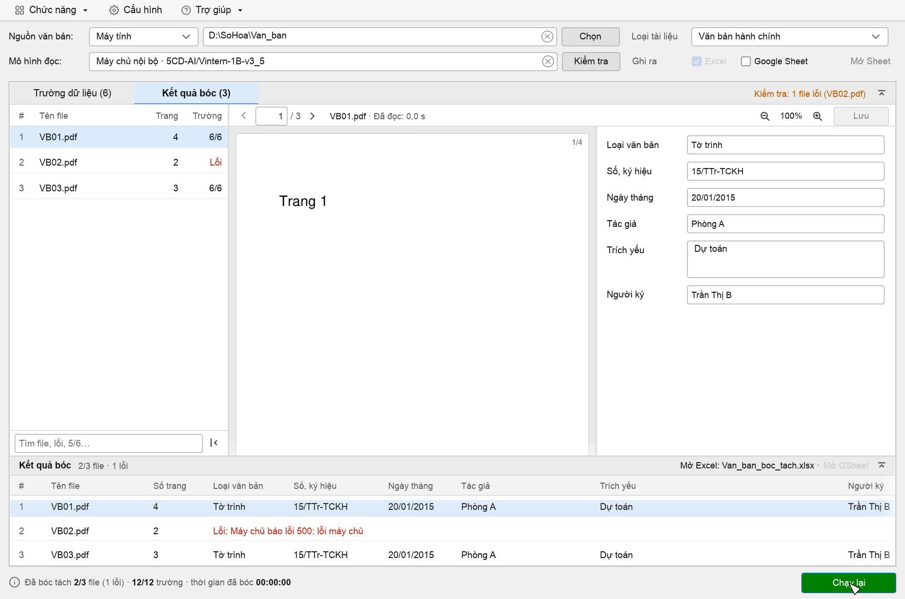
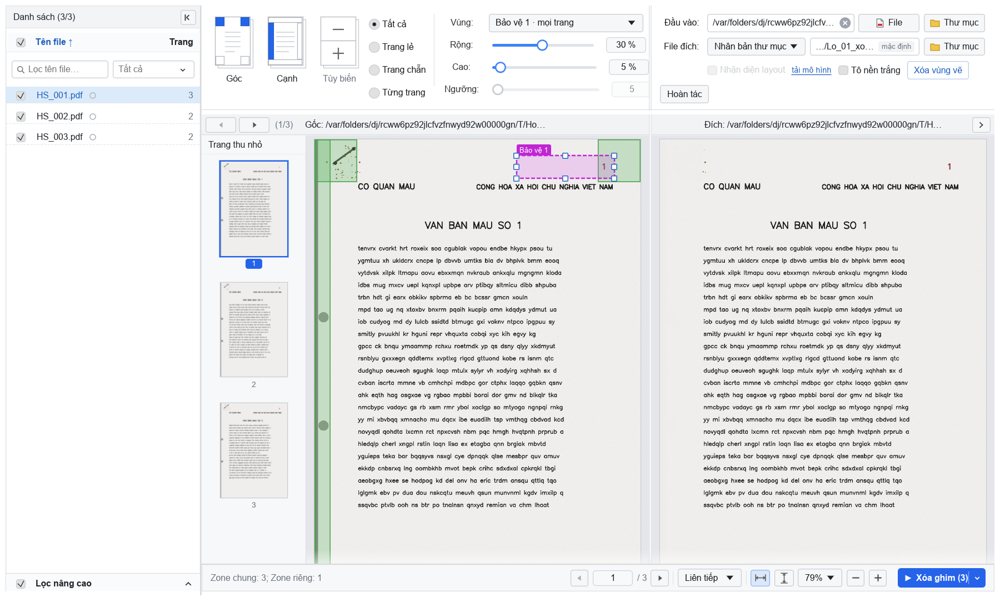
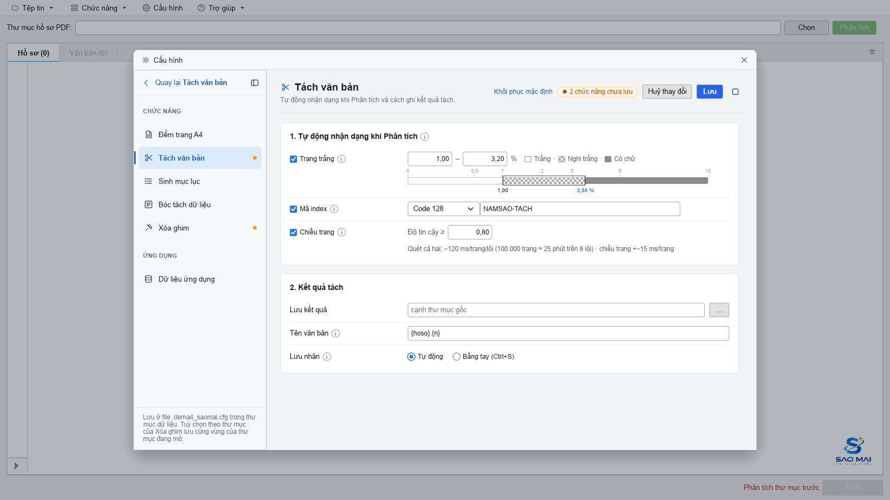

# dema4-saomai

Ứng dụng hỗ trợ nghiệp vụ số hoá tài liệu (Giải pháp số Sao Mai):

- **Đếm trang A4** — đếm trang mọi PDF trong thư mục, phân loại khổ A0–A7, quy đổi ra số trang A4.
- **Tách văn bản** — tách hồ sơ PDF scan thành từng văn bản theo tờ index (mã vạch), bỏ trang trắng, gợi ý trang xoay.
- **Sinh mục lục hồ sơ** — từ file biên mục Excel/CSV và mẫu DOCX, sinh mục lục cho từng hồ sơ.
- **Bóc tách dữ liệu** — đọc văn bản PDF bằng mô hình AI (máy chủ nội bộ hoặc Gemini / Claude / GPT / OpenRouter) lấy số ký hiệu, ngày, trích yếu, tác giả, người ký…; ghi Excel và Google Sheet.
- **Xóa ghim** — xoá vết ghim / kẹp / lỗ bấm / bóng mép trên PDF scan theo vùng góc, cạnh hoặc vẽ tay; giữ nét chữ, xem trước đúng như file xuất.
- **Chuẩn hoá tên**, **Ký văn bản**, **Đóng gói AIP** — đang phát triển.

Một file chạy duy nhất, không cần cài đặt. Tải ở [Releases](https://github.com/quangtv1/dema4/releases): `dema4_saomai.exe` (Windows x64) · `dema4_saomai` (macOS Apple Silicon). Trong app: **Trợ giúp › Kiểm tra cập nhật**.

Lần đầu mở (file chưa ký số với Apple / Microsoft):

- **macOS**: **System Settings › Privacy & Security › Open Anyway**, hoặc `xattr -d com.apple.quarantine ~/Downloads/dema4_saomai && chmod +x ~/Downloads/dema4_saomai`.
- **Windows** (SmartScreen): **More info › Run anyway**.
- **Windows, mở không lên cửa sổ** (máy card Intel driver cũ): từ v2.2.2 app không còn dò Vulkan nên không còn crash ở `igvk64.dll`. Vẫn không lên → cập nhật driver card đồ hoạ, hoặc thử chạy trong PowerShell: `$env:WGPU_BACKEND="gl"; .\dema4_saomai.exe`.

**Nâng cấp lên v2.6.0**: màn **Xóa ghim** làm lại (Danh sách lọc / sắp xếp, File đích nhân bản / cạnh file gốc / ghi đè, chọn nhiều vùng, Nhận diện layout bằng AI, Cấu hình › Xóa ghim); **Cấu hình** thành trang toàn cửa sổ có sidebar chức năng (hoặc cửa sổ thu nhỏ), Lưu trên tiêu đề, mục **Dữ liệu ứng dụng**; menu **Tệp tin** đầu mọi chức năng (Mở…, Gần đây, Xuất / Nhập phiên). Kho Xóa ghim của 2.6.0 vẫn mở được ở 2.5.0 (bản cũ bỏ qua phần File đích và cờ Nhận diện layout).

**Nâng cấp lên v2.5.0**: thêm chức năng **Xóa ghim** (ô trên Trang chủ, menu Chức năng). Lượt chạy Xóa ghim tính chung hạn mức với các chức năng khác. Phần Xóa ghim lưu ở file kho riêng `kho_xoa_ghim.bin`; dùng song song / quay về bản 2.4.1 không mất dữ liệu của bản này (bản 2.4.0 trở về trước gặp dòng Xóa ghim thì xoá trắng cả danh sách Làm tiếp gần đây và bỏ lượt Xóa ghim chưa gửi trạm — máy nào cần giữ bản cũ thì cập nhật lên 2.4.1 trở lên).

**Nâng cấp lên v2.4.0**: phần đã làm ở Tách (nhãn, góc xoay, cờ duyệt, kết quả phân tích) chuyển vào **1 kho theo nội dung từng PDF** — đổi tên / di chuyển thư mục, mở thư mục cha hay con, chép sang ổ khác vẫn thấy lại, tới từng file. Dữ liệu bản 2.3 tự chuyển vào kho lần đầu mở thư mục (file cũ giữ nguyên). Cùng 1 PDF ở nhiều chỗ dùng chung nhãn. Chỉ mở được 1 cửa sổ app.

**Nâng cấp lên v2.3.0**: dữ liệu làm việc chuyển sang thư mục dữ liệu của người dùng (xem [Dữ liệu làm việc](#dữ-liệu-làm-việc-và-làm-tiếp-trên-máy-khác)); bản mới **không mang dữ liệu bản cũ sang** — làm xong / xuất Excel phần đang dở trước khi nâng cấp, sau đó dán lại khoá API và chỉnh lại Cấu hình. Số lượt chạy lấy từ trạm: máy chưa từng kích hoạt, và máy Windows lần chạy đầu sau nâng cấp, **cần có mạng**. Thư mục `.sm-dema4` cạnh file chạy của bản cũ không còn dùng, xoá tay được (quay lại bản cũ thì bản cũ vẫn đọc thư mục đó, không thấy phần làm trên bản mới).

**Hướng dẫn sử dụng chi tiết** (có hình minh hoạ): [docs/huong-dan/huong-dan-su-dung-dema4.docx](docs/huong-dan/huong-dan-su-dung-dema4.docx) · [bản PDF](docs/huong-dan/huong-dan-su-dung-dema4.pdf).

## Trang chủ

Mở app vào Trang chủ: bấm ô chức năng để bắt đầu (rê chuột xem tóm tắt). Về Trang chủ: menu **Chức năng › Trang chủ** hoặc bấm logo Sao Mai góc dưới phải màn giới thiệu.

**Làm tiếp gần đây**: 5 thư mục / file vừa làm (Đếm, Tách, Mục lục, Bóc tách, Xóa ghim) kèm tình trạng lúc rời màn — bấm 1 dòng là mở lại đúng chức năng, đúng thư mục (Bóc tách: cả loại tài liệu; Mục lục: cả sheet, dòng tiêu đề, mẫu). Thư mục đã đổi chỗ → **Chọn lại…**; × bỏ 1 dòng, **Xoá lịch sử** bỏ hết. Cùng danh sách ở **Tệp tin › Gần đây**.


## Đếm trang A4

Chọn thư mục (gồm cả thư mục con) → **Đếm**. Lọc theo khổ (tab A0–A7), bấm tên file để mở. Tuỳ chọn **Check ký số**, **Check DPI**. Xong tự lưu `<thư mục>_dem.txt` và `_dem_chitiet.txt`; popup có **Mở kết quả** · **Copy dữ liệu** (dán vào Excel).


## Tách văn bản

1. **Chọn thư mục → Phân tích**: nhãn tự động (Index, Trắng, Nghi trắng, Nghi xoay) hiện dần theo từng hồ sơ; có thể Dừng và phân tích tiếp lần sau.
2. **Tab Hồ sơ**: sửa nhãn bằng phím **S** (Split) · **I** (Index) · **B** (Trắng) · **C** (bỏ nhãn) · **90 / 180** (xoay); bấm đúp để phóng to.
3. **Duyệt Nghi trắng / Nghi xoay** (bắt buộc trước khi tách).
4. **Tab Văn bản**: xem trước từng văn bản sẽ sinh ra.
5. **Tách** → `<thư mục gốc>_vanban/…/<hồ sơ>/<hồ sơ>.1.pdf …`, giữ cấu trúc thư mục con; file PDF gốc không bị sửa.


Nhãn, cache và log nằm trong [thư mục dữ liệu](#dữ-liệu-làm-việc-và-làm-tiếp-trên-máy-khác), không ghi vào thư mục đầu vào.

## Sinh mục lục hồ sơ

1. **File biên mục**: Excel (.xlsx .xlsb .xls) hoặc CSV, mỗi văn bản một dòng, các dòng cùng hồ sơ liền nhau; chọn sheet và **Dòng tiêu đề** (nút ⌄ xem 10 dòng đầu).
2. **Mẫu mục lục**: 4 mẫu có sẵn hoặc mẫu DOCX riêng (biến dạng `{ten_bien}`).
3. **Tab Mẫu**: biến tự khớp cột cùng tên; bấm ô **Lấy từ** để chọn cột khác hoặc gõ giá trị cố định. **Nhóm theo** = cột tách hồ sơ.
4. **Tab Kết quả**: xem trước mục lục từng hồ sơ.
5. **Sinh mục lục** → mỗi hồ sơ một file DOCX (tên mặc định `MLHS_{so_ho_so}`).

Ví dụ **Mẫu 04 – Vĩnh Phúc** với file biên mục có đủ cột (Số hồ sơ, Tên hồ sơ, STT, Số ký hiệu, Ngày tháng, Trích yếu, Tác giả, Tờ số, Ghi chú): 11/11 biến tự ghép, tab Kết quả ra mục lục từng hồ sơ.




## Bóc tách dữ liệu

1. **Nguồn văn bản**: chọn thư mục PDF (gồm thư mục con).
2. **Mô hình đọc**: mô hình đã khai ở **Cấu hình › Bóc tách** — máy chủ nội bộ (vLLM / Ollama / LM Studio, địa chỉ chuẩn OpenAI `http://<máy>:<cổng>/v1`), Gemini (Vertex AI express mode hoặc AI Studio), Claude, GPT, OpenRouter. Dịch vụ đám mây có sẵn địa chỉ và danh sách model: chỉ cần dán khoá API (Gemini mặc định `gemini-3.7-flash` qua Vertex AI); địa chỉ sửa được khi đi qua proxy riêng (bắt buộc `https://`).
3. **Loại tài liệu**: Văn bản hành chính, Hồ sơ đất đai, Hợp đồng hoặc loại riêng. Tab **Trường dữ liệu** xem các trường và câu lệnh gửi mô hình, sửa tên cột / mô tả / chuẩn hoá; **Thử đọc** file đang xem (không trừ lượt chạy).
4. **Bắt đầu**: tab **Kết quả bóc** hiện từng file (PDF bên trái, các trường bên phải), sửa tay rồi **Lưu**; lọc `lỗi` / `5/6` rồi **Chạy lại (n)** chỉ đọc lại các file đang hiện. Tắt app giữa chừng (app hỏi trước khi tắt) → mở lại qua **Làm tiếp gần đây**: kết quả đã đọc còn nguyên, nút **Tiếp tục (n)** chỉ đọc n file còn lại.
5. Kết quả: `<thư mục>_boc_tach.xlsx` cạnh thư mục nguồn — mỗi file 1 dòng, nạp thẳng vào **Sinh mục lục** làm file biên mục; bật **Google Sheet** để có tab bản sao kết quả (tab trống = tên thư mục nguồn): có thay đổi thì tự ghi lại cả tab, tối đa 1 lần mỗi phút (khoá service account hoặc Apps Script — script mẫu `dema4_rs/apps-script-mau/boc_tach.gs`; bản trước v2.1.2 cần dán lại script mới). Kết quả (cả phần sửa tay) còn được gửi về trạm Sao Mai để sao lưu, nâng chất lượng bóc tách — mỗi máy 1 thư mục theo mã máy.

Mỗi trang cần đọc được gửi tới mô hình đọc đã chọn: máy chủ nội bộ thì ảnh không ra khỏi mạng đơn vị; dịch vụ đám mây thì ảnh gửi tới máy chủ của hãng (không dùng cho tài liệu mật). Khoá API lưu mã hoá trên máy.





## Xóa ghim

Mở 1 file PDF hoặc cả thư mục (nút giữa màn, **Tệp tin › Mở…**, ô **Đầu vào** hoặc kéo thả) → bấm góc / cạnh trên biểu tượng **Góc**, **Cạnh**, hoặc vẽ vùng bằng **Tùy biến** (− xoá, + bảo vệ) trên trang **Gốc** → xem khung **Đích** → **Xóa ghim (n)** góc dưới phải.

- **Danh sách** (trái): kéo mép đổi rộng, thu nhỏ thành dải dọc; sắp **Tên file** / **Trang**; lọc tên, lọc gộp theo trạng thái hoặc số trang (`1-3, 7, >10`); **Lọc nâng cao** theo khổ A0–A7 (xếp khổ như Đếm A4), chiều, dải trang — mặc định chọn hết, ô không có trang mờ; tick là lọc ngay, dải trang áp sau 2 giây; **Reset** để bỏ lọc. Tick file để chạy.
- **Vùng**: góc / cạnh có sẵn (xanh lá; cạnh luôn hết chiều dài trang), vẽ tay xoá (xanh lam), **Bảo vệ** (hồng, nét đứt), **Vô đối** (cam, xoá cả trong vùng bảo vệ). Phạm vi **Tất cả / Trang lẻ / Trang chẵn / Từng trang** theo vùng đang chọn. Chỉnh **Rộng / Cao** (% trang), **Ngưỡng** bằng thanh trượt hoặc ô số; kéo cạnh / thân để đổi cỡ / di chuyển. Chọn nhiều kiểu AutoCAD (kéo sang phải = nằm trọn, sang trái = chạm), `Shift`, `Ctrl+A`; `Delete` xoá vùng vẽ, chuột phải đổi loại / nhân bản / phạm vi; **Xóa vùng vẽ** (có hỏi lại); `Ctrl+Z` hoàn tác. `F1`: bảng thao tác nhanh.
- **Chế độ mini**: nút **^** góc phải thanh menu thu thanh công cụ thành 1 hàng biểu tượng (4 góc · 4 cạnh · − / + vẽ vùng · phạm vi trang · Xóa vùng vẽ · AI) để có thêm chỗ xem trang; bấm lại để mở đầy đủ.
- **Xem trước = file xuất**: Gốc | Đích rộng bằng nhau, cuộn cùng nhau; ảnh Đích vẽ ở đúng DPI sẽ xuất bằng đúng bước xoá (chỉ khác ở nén JPEG). Liên tiếp / Từng trang, vừa ngang / vừa cao, 25–150 %.
- **File đích**: **Thư mục mới** (`<nguồn>_xoaghim/` hoặc thư mục chọn bằng nút **Chọn**, giữ thư mục con và tên file), **Cạnh gốc** (`<tên>_xoaghim.pdf`), hoặc **Ghi đè file gốc** (Cấu hình, không hoàn tác được).
- **Nhận diện layout** (AI, YOLOv12s-DocLayNet): không xoá vào khối chữ / bảng; tải mô hình 37,5 MB một lần ở **Cấu hình › Xóa ghim** (kiểm SHA-256), sau đó chạy ngoại tuyến.
- **Trạng thái** cạnh từng file: ✓ đã xoá, ↻ đã đổi vùng / tuỳ chọn, ! kết quả mất, ○ chưa xoá; **Xóa ghim (n)** chỉ chạy file đã tick cần chạy, ▾ › **Chạy lại mọi file đã tick**. Hộp kết quả: **Mở thư mục**, **Mở ở Tách**.
- Vùng / tuỳ chọn theo thư mục lưu tự động (chung theo thư mục, riêng theo nội dung từng PDF); mang sang máy khác bằng **Tệp tin › Xuất / Nhập phiên làm việc**. Nên **Xóa ghim trước** rồi mới gắn nhãn ở Tách. Xóa ghim chỉ tô lại vùng có vết — không phải công cụ che thông tin.



## Cấu hình

Menu **Cấu hình** mở **trang Cấu hình** thay màn đang làm (mở sẵn mục của màn đó), lưu ở file `.dema4_saomai.cfg` trong thư mục dữ liệu.

- **Sidebar trái**: Đếm trang A4 · Tách văn bản · Sinh mục lục · Bóc tách dữ liệu · Xóa ghim, và **Dữ liệu ứng dụng** (thư mục dữ liệu + Mở thư mục, Xoá cache phân tích của thư mục Tách đang mở, Dọn dữ liệu cũ — có hỏi lại). Mục còn thay đổi chưa lưu có chấm cam. Nút cạnh **Quay lại** (Ctrl+B) thu sidebar thành dải biểu tượng.
- **Hàng tiêu đề**: Khôi phục mặc định (chỉ mục đang xem) · nhãn "n chức năng chưa lưu" · **Huỷ thay đổi** · **Lưu** (Ctrl+S, ở lại trang; ô báo đỏ thì khoá) · nút cửa sổ: ⧉ thu thành **cửa sổ 1120 × 720** nổi trên màn đang làm, □ trở lại toàn cửa sổ (Ctrl+M). Dạng hiển thị được nhớ.
- **Quay lại <màn>** / Esc (cửa sổ thu nhỏ: ✕, bấm ra ngoài): còn thay đổi thì hỏi **Không lưu · Ở lại · Lưu và quay lại**.
- Mọi mục cùng cột nội dung cố định — đổi mục không nhảy bố cục.





## Dữ liệu làm việc và làm tiếp trên máy khác

Mọi dữ liệu làm việc (cấu hình, khoá API mã hoá, license, nhãn / cache / log Tách, kết quả Bóc tách, lịch sử gần đây) nằm ở **một chỗ cố định theo người dùng**, không phụ thuộc chỗ đặt file chạy — dời / chép file chạy sang thư mục khác vẫn làm tiếp được:

- Windows: `%LOCALAPPDATA%\sm-dema4`
- macOS: `~/Library/Application Support/sm-dema4`

Phần Tách (nhãn, góc xoay, cờ duyệt, kết quả phân tích) nằm trong **1 file kho** `kho_tach.bin`, khoá theo **nội dung từng PDF** (64 KB đầu + 64 KB cuối + kích thước) chứ không theo đường dẫn: đổi tên / di chuyển thư mục, mở thư mục cha hay con, chép sang ổ khác vẫn thấy lại phần đã làm của từng file, không phân tích lại. Cùng 1 PDF ở nhiều chỗ dùng chung nhãn. Trước khi **Tách**, app đọc lại nội dung từng file: file đã bị thay bản khác (cùng tên) không bị tách theo nhãn cũ. Vùng + nhật ký Xóa ghim ở file kho riêng `kho_xoa_ghim.bin` (cùng cách ghi). Kết quả Bóc tách vẫn ở `viec/<thư mục>/boc_tach.jsonl`, mỗi kết quả kèm id nội dung nên cũng tìm lại được khi đổi tên / di chuyển. Kho ghi nối từng thay đổi nhỏ (sửa 1 nhãn ghi vài chục byte), tắt máy giữa chừng không hỏng; **Cấu hình › Dữ liệu ứng dụng › Dọn dữ liệu cũ** bỏ phần đã làm của PDF không mở lại quá 12 tháng. Chỉ mở được 1 cửa sổ app (1 nơi ghi kho).

**Làm tiếp trên máy khác** (màn Tách, Bóc tách hoặc Xóa ghim, đã mở thư mục): **Tệp tin › Xuất phiên làm việc…** đóng gói nhãn, góc xoay, cache phân tích, kết quả bóc tách và vùng Xóa ghim của thư mục đó thành `<tên>.sm-dema4.zip` (mặc định vào thư mục Tải về; không có khoá API, license, cấu hình). Ở máy kia mở thư mục chứa các PDF đó — **cấp nào, tên gì cũng được**: khớp theo nội dung file — rồi **Tệp tin › Nhập phiên làm việc…**: hộp xác nhận cho biết % PDF khớp, loại tài liệu mới; mỗi hồ sơ giữ **bản sửa sau cùng** (máy này hoặc gói), kết quả bóc tách đọc được không bị bản lỗi đè; báo cáo liệt kê hồ sơ hai máy cùng sửa. Nên chia hồ sơ cho từng người, không đổi ngưỡng / Phân tích lại giữa chừng, và để đồng hồ máy đúng giờ.

## Dòng lệnh

```
dema4_saomai <thư mục> [--dpi] [--kyso] [--khong-ghi]                        # Đếm
dema4_saomai --tach <thư mục pdf> [--nhan <file nhãn>] [--xuat-nhan <file>] [--ra <thư mục cha>]
                                     # nhãn lấy từ kho (chưa có → phân tích tự động); --nhan: file nhãn dạng chữ ngoài;
                                     # --xuat-nhan: ghi nhãn trong kho ra file chữ rồi dừng; ứng dụng đang mở → báo, không chạy
```

## Trợ giúp

**Trợ giúp › Hướng dẫn sử dụng** (F1) mở đúng tab của màn đang dùng; **Thông tin** có phiên bản và website.


Sau mỗi lần chạy xong, app gửi số liệu thống kê (không gửi nội dung tài liệu) về Sao Mai và báo trong popup kết quả. Riêng **Bóc tách** gửi ảnh trang PDF tới mô hình đọc do người dùng chọn để lấy dữ liệu; thống kê gửi về Sao Mai chỉ gồm số file / trang / trường và tên mô hình.

## Build từ mã nguồn

Cần Rust; Windows cần thêm Visual Studio Build Tools (C++) và LLVM.

```
cd dema4_rs
cargo build --release
```

GitHub Actions tự build macOS (arm64) và Windows (x64); tag `vX.Y.Z` tạo Release kèm file chạy.

## Giấy phép thành phần

MuPDF (AGPL) · zxing-cpp (Apache 2.0) · ONNX Runtime (MIT) · PP-LCNet_x1_0_doc_ori của PaddleOCR (Apache 2.0, `dema4_rs/assets/NOTICE-doc_ori.txt`) · egui (MIT / Apache 2.0) · rust_xlsxwriter, aes-gcm (MIT / Apache 2.0) · jpeg-encoder (MIT / Apache 2.0; *this software is based in part on the work of the Independent JPEG Group*).
