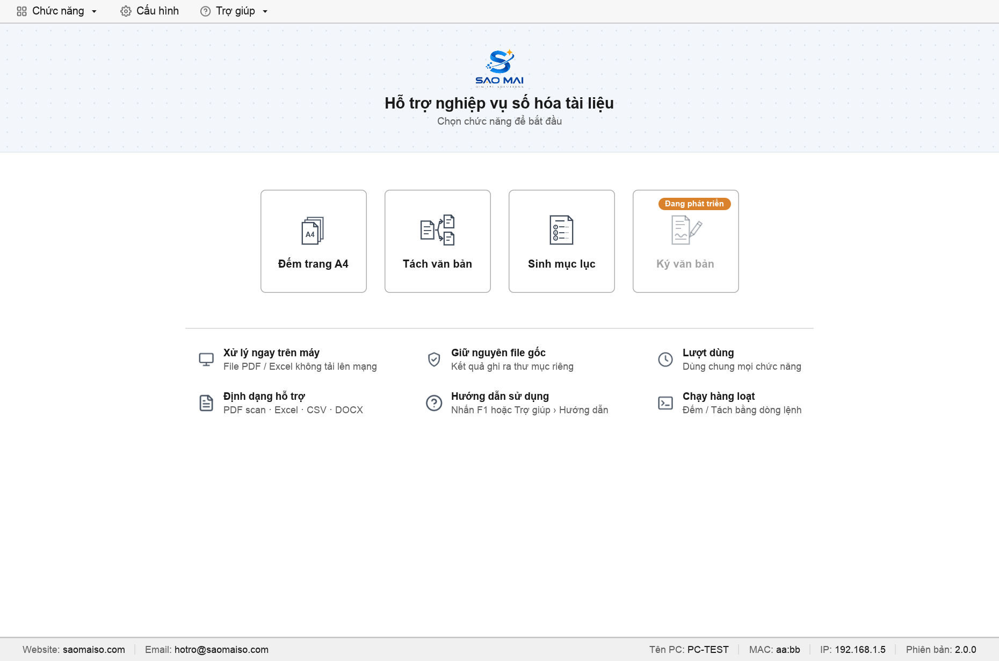
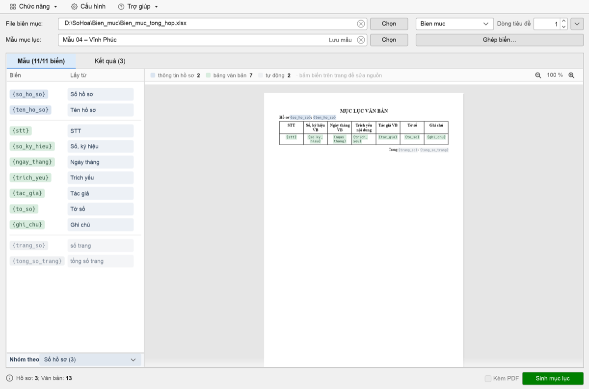
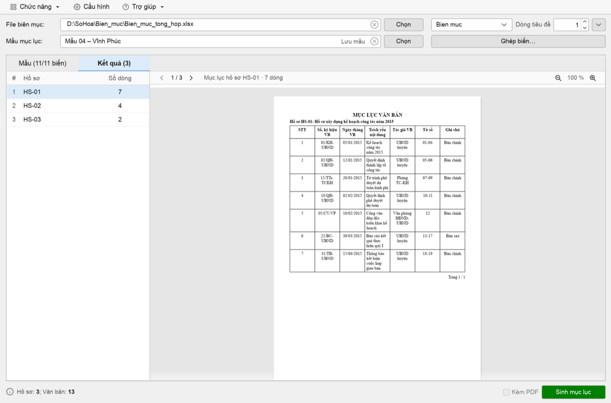

# dema4-saomai

Ứng dụng hỗ trợ nghiệp vụ số hoá tài liệu (Giải pháp số Sao Mai):

- **Đếm trang A4** — đếm trang mọi PDF trong thư mục, phân loại khổ A0–A7, quy đổi ra số trang A4.
- **Tách văn bản** — tách hồ sơ PDF scan thành từng văn bản theo tờ index (mã vạch), bỏ trang trắng, gợi ý trang xoay.
- **Sinh mục lục hồ sơ** — từ file biên mục Excel/CSV và mẫu DOCX, sinh mục lục cho từng hồ sơ.
- **Ký văn bản** — đang phát triển.

Một file chạy duy nhất, không cần cài đặt. Tải ở [Releases](https://github.com/quangtv1/dema4/releases): `dema4_saomai.exe` (Windows x64) · `dema4_saomai` (macOS Apple Silicon). Trong app: **Trợ giúp › Kiểm tra cập nhật**.

Lần đầu mở (file chưa ký số với Apple / Microsoft):

- **macOS**: **System Settings › Privacy & Security › Open Anyway**, hoặc `xattr -d com.apple.quarantine ~/Downloads/dema4_saomai && chmod +x ~/Downloads/dema4_saomai`.
- **Windows** (SmartScreen): **More info › Run anyway**.

## Trang chủ

Mở app vào Trang chủ: bấm ô chức năng để bắt đầu (rê chuột xem tóm tắt). Về Trang chủ: menu **Chức năng › Trang chủ** hoặc bấm logo Sao Mai góc dưới phải màn giới thiệu.



## Đếm trang A4

Chọn thư mục (gồm cả thư mục con) → **Đếm**. Lọc theo khổ (tab A0–A7), bấm tên file để mở. Tuỳ chọn **Check ký số**, **Check DPI**. Xong tự lưu `<thư mục>_dem.txt` và `_dem_chitiet.txt`; popup có **Mở kết quả** · **Copy dữ liệu** (dán vào Excel).


## Tách văn bản

1. **Chọn thư mục → Phân tích**: nhãn tự động (Index, Trắng, Nghi trắng, Nghi xoay) hiện dần theo từng hồ sơ; có thể Dừng và phân tích tiếp lần sau.
2. **Tab Hồ sơ**: sửa nhãn bằng phím **S** (Split) · **I** (Index) · **B** (Trắng) · **C** (bỏ nhãn) · **90 / 180** (xoay); bấm đúp để phóng to.
3. **Duyệt Nghi trắng / Nghi xoay** (bắt buộc trước khi tách).
4. **Tab Văn bản**: xem trước từng văn bản sẽ sinh ra.
5. **Tách** → `<thư mục gốc>_vanban/…/<hồ sơ>/<hồ sơ>.1.pdf …`, giữ cấu trúc thư mục con; file PDF gốc không bị sửa.


Nhãn, cache và log nằm trong thư mục ẩn `.sm-dema4/` cạnh file chạy, không ghi vào thư mục đầu vào.

## Sinh mục lục hồ sơ

1. **File biên mục**: Excel (.xlsx .xlsb .xls) hoặc CSV, mỗi văn bản một dòng, các dòng cùng hồ sơ liền nhau; chọn sheet và **Dòng tiêu đề** (nút ⌄ xem 10 dòng đầu).
2. **Mẫu mục lục**: 4 mẫu có sẵn hoặc mẫu DOCX riêng (biến dạng `{ten_bien}`).
3. **Tab Mẫu**: biến tự khớp cột cùng tên; bấm ô **Lấy từ** để chọn cột khác hoặc gõ giá trị cố định. **Nhóm theo** = cột tách hồ sơ.
4. **Tab Kết quả**: xem trước mục lục từng hồ sơ.
5. **Sinh mục lục** → mỗi hồ sơ một file DOCX (tên mặc định `MLHS_{so_ho_so}`).


Ví dụ **Mẫu 04 – Vĩnh Phúc** với file biên mục có đủ cột (Số hồ sơ, Tên hồ sơ, STT, Số ký hiệu, Ngày tháng, Trích yếu, Tác giả, Tờ số, Ghi chú): 11/11 biến tự ghép, tab Kết quả ra mục lục từng hồ sơ.





## Cấu hình

Menu **Cấu hình** (3 tab Đếm trang A4 / Tách PDF / Sinh mục lục), lưu ở file ẩn `.dema4_saomai.cfg` cạnh file chạy.


## Dòng lệnh

```
dema4_saomai <thư mục> [--dpi] [--kyso] [--khong-ghi]                        # Đếm
dema4_saomai --tach <thư mục pdf> [--nhan <index_and_blank.txt>] [--ra <thư mục cha>]
```

## Trợ giúp

**Trợ giúp › Hướng dẫn sử dụng** (F1) mở đúng tab của màn đang dùng; **Thông tin** có phiên bản và website.


Sau mỗi lần chạy xong, app gửi số liệu thống kê (không gửi nội dung tài liệu) về Sao Mai và báo trong popup kết quả.

## Build từ mã nguồn

Cần Rust; Windows cần thêm Visual Studio Build Tools (C++) và LLVM.

```
cd dema4_rs
cargo build --release
```

GitHub Actions tự build macOS (arm64) và Windows (x64); tag `vX.Y.Z` tạo Release kèm file chạy.

## Giấy phép thành phần

MuPDF (AGPL) · zxing-cpp (Apache 2.0) · ONNX Runtime (MIT) · PP-LCNet_x1_0_doc_ori của PaddleOCR (Apache 2.0, `dema4_rs/assets/NOTICE-doc_ori.txt`) · egui (MIT / Apache 2.0).
