# dema4

Ứng dụng `dema4_saomai` (Giải pháp số Sao Mai) hỗ trợ số hoá hồ sơ scan, 3 chức năng:

- **Đếm trang A4**: phân loại khổ giấy A0–A7, quy đổi ra số trang A4 theo hệ số, cảnh báo trang sát ngưỡng chuyển khổ, trang có DPI bất thường, file đã ký số.
- **Tách văn bản**: tách hồ sơ PDF scan thành từng văn bản theo tờ index (mã Code 128), bỏ trang trắng, gợi ý trang scan bị xoay; duyệt và sửa nhãn trên giao diện trước khi tách.
- **Sinh mục lục hồ sơ**: từ file biên mục Excel/CSV và mẫu DOCX của đơn vị, sinh mục lục văn bản cho từng hồ sơ (mỗi hồ sơ một file DOCX); xem mẫu, ghép biến với cột, xem trước từng hồ sơ trước khi sinh.

Mở app vào **Trang chủ**: 4 ô chức năng (rê chuột xem tóm tắt, bấm để vào), thông tin nhanh (lượt dùng, định dạng hỗ trợ, phím F1…) và thanh đáy (website, email, tên máy, MAC, IP, phiên bản). Về Trang chủ: menu **Chức năng › Trang chủ** hoặc bấm logo Sao Mai góc dưới phải màn giới thiệu.

Một file chạy duy nhất, không cần cài thêm gì.

Tải bản mới nhất ở [Releases](https://github.com/quangtv1/dema4/releases): `dema4_saomai.exe` (Windows x64) · `dema4_saomai` (macOS Apple Silicon). Trong app: **Trợ giúp › Kiểm tra cập nhật**.

Mỗi máy dùng thử **10 lần**, dùng chung cho Đếm, Tách và Sinh mục lục; cần thêm lượt liên hệ Sao Mai — xem [Lượt dùng](#lượt-dùng-license).

File chạy chưa ký số với Apple / Microsoft nên lần đầu mở hệ điều hành sẽ cảnh báo:

- **macOS** ("cannot be opened because it is from an unidentified developer"): bấm OK, vào **System Settings › Privacy & Security › Open Anyway**; hoặc trong Terminal `xattr -d com.apple.quarantine ~/Downloads/dema4_saomai && chmod +x ~/Downloads/dema4_saomai`.
- **Windows** (SmartScreen): **More info › Run anyway**.

`dema4_rs/` — mã nguồn Rust (giao diện egui + chế độ dòng lệnh), build qua GitHub Actions. Bản gốc Python (PyQt5 + PyMuPDF) giữ cục bộ trong `temp/`, không đưa lên repo.

Mỗi chức năng khi chưa có dữ liệu hiện màn giới thiệu 3 bước; link **Chọn** / **Phân tích** trong đó làm đúng việc của nút, logo góc dưới phải về Trang chủ. Màn Tách: chọn thư mục xong thì tên hồ sơ hiện ngay ở cột trái, khung phải thay giới thiệu bằng số hồ sơ + nút **Phân tích**.

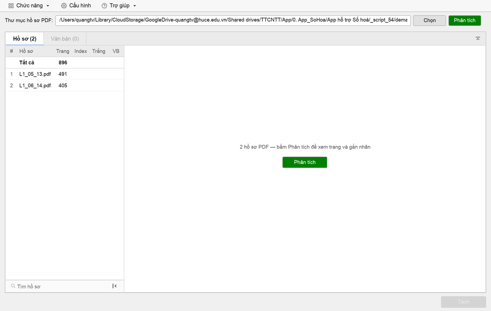

## Đếm trang A4

Chọn thư mục (quét cả thư mục con) → **Đếm**. Bảng kết quả lọc theo khổ (tab A0–A7), bấm tên file để mở. Tuỳ chọn **Check ký số** (AcroForm) và **Check DPI** (chậm hơn). Xong: tự lưu `<thư mục>_dem.txt` và `_dem_chitiet.txt`; popup có **Mở kết quả** · **Copy dữ liệu** (dán thẳng vào Excel).

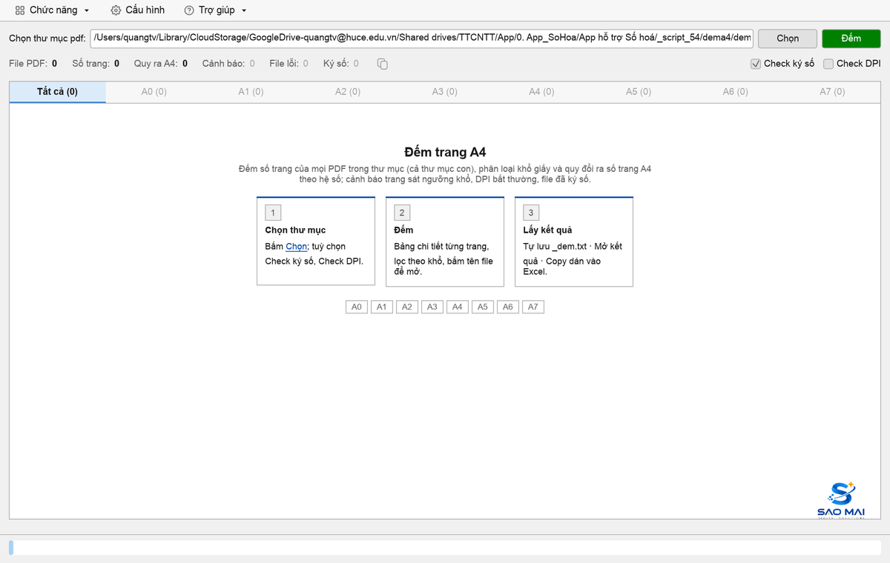

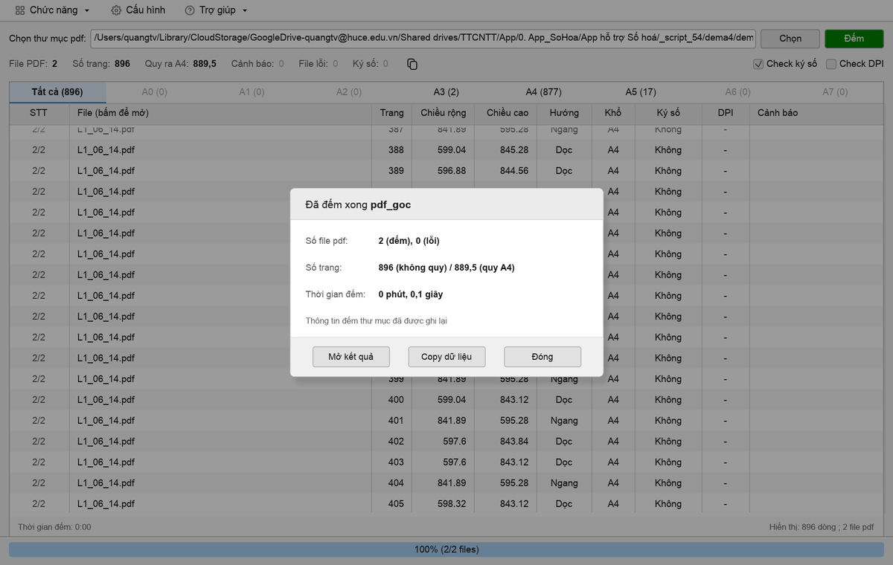

## Tách văn bản

Menu **Chức năng › Tách văn bản** (chi tiết trong **Trợ giúp › Hướng dẫn sử dụng**, F1).

**1. Chọn thư mục → Phân tích.** Cột trái hiện ngay tên các PDF theo cây thư mục; nhãn tự động (Index, Trắng, Nghi trắng, Nghi xoay) đến dần, hồ sơ nào xong lưới tự nhảy tới trang cuối của hồ sơ đó. Dùng nhiều luồng nhưng hiển thị lần lượt từ hồ sơ 1. Có thể **Dừng** rồi phân tích tiếp lần sau (kết quả đã có được cache).

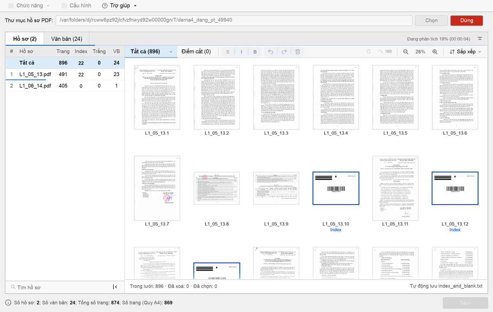

**2. Tab Hồ sơ: kiểm tra và sửa nhãn.** Phím **S** (Split — văn bản mới bắt đầu từ trang này), **I** (Index), **B** (Trắng), **C** (bỏ nhãn), **90 / 180** xoay, **Delete** bỏ trang khỏi lưới. Chọn trang như Windows Explorer (Ctrl / Shift / kéo khung, PgUp / PgDn); chuột phải có menu; Ctrl+Z / Ctrl+Y riêng từng nhóm lọc. Bấm đúp vào trang để phóng to (zoom tới 250 %).

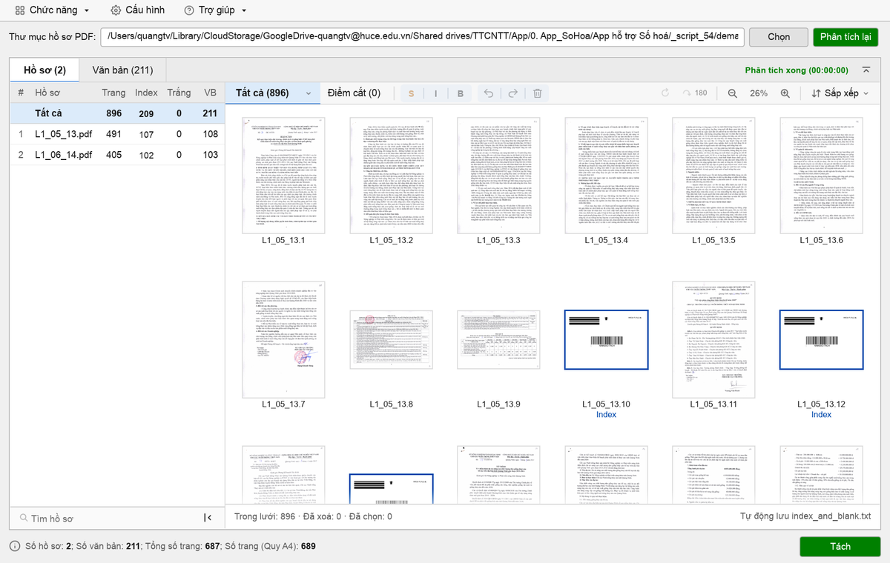

**3. Duyệt Nghi trắng và Nghi xoay** (menu lọc) — bắt buộc trước khi tách. Nghi trắng: bấm B / C / I / S để chọn nhãn thật (mặc định Trắng) rồi Enter; Nghi xoay: Enter xoay thử, Enter lần nữa xác nhận. Xong tự sang trang nghi kế. Phóng to 1 trang vẫn có thanh duyệt, cùng phím tắt, Hoàn tác / Làm lại (Ctrl+Z / Ctrl+Y).

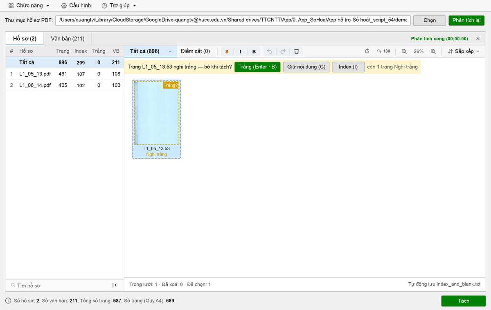

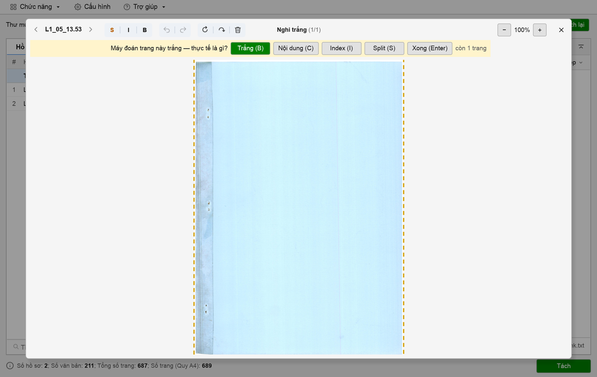

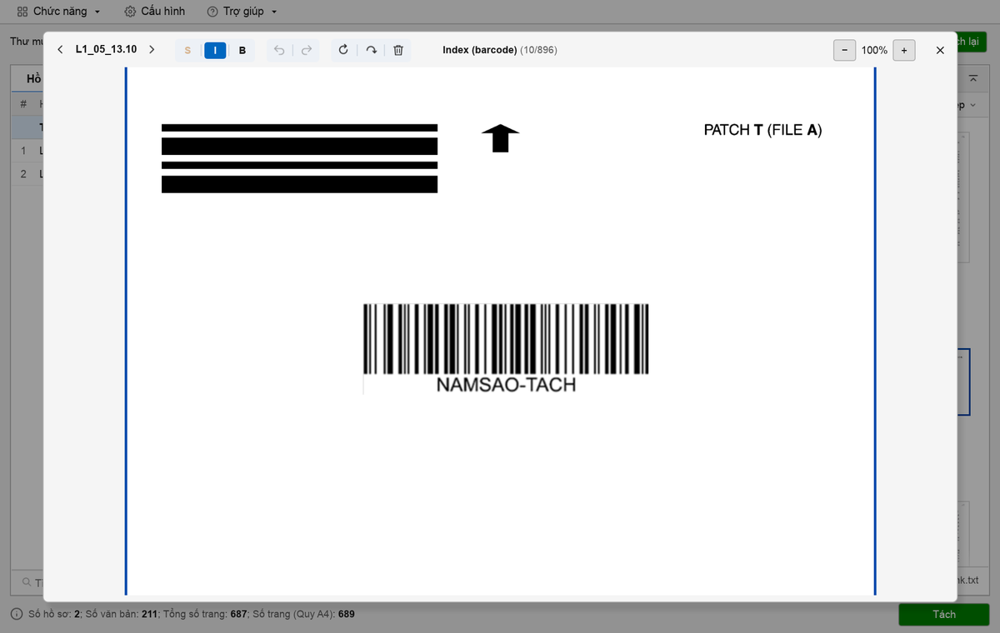

**4. Tab Văn bản: xem trước từng văn bản** sẽ sinh ra (Lưới · 1 trang · 2 trang), xoay hoặc **Bỏ khỏi văn bản** nếu cần. Tên file theo mẫu trong Cấu hình (mặc định `{hoso}.{n}`; `{n7}` → `0000001`).

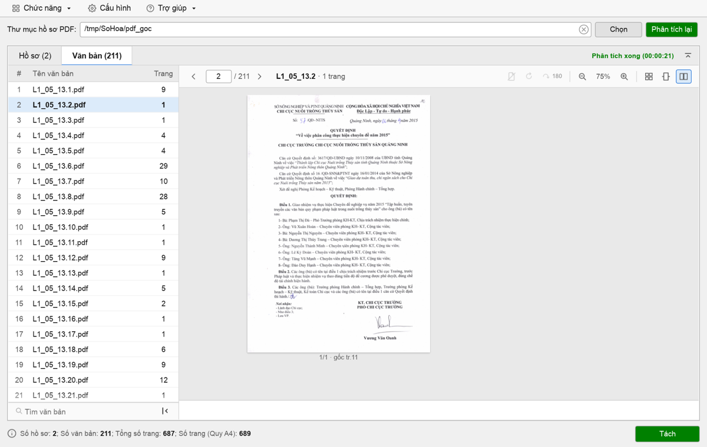

**5. Tách** → `<thư mục gốc>_vanban/…/<hồ sơ>/<hồ sơ>.1.pdf …`, giữ nguyên cấu trúc thư mục con. Hồ sơ không có nhãn và không xoay được chép nguyên từng byte (giữ chữ ký số). Mỗi văn bản ghi qua file tạm rồi mới đổi tên, nên tắt máy giữa chừng không để lại PDF cụt. Trong lúc tách, popup hiện tiến độ theo văn bản, văn bản đang tạo, số đã xong, thời gian đã chạy / còn lại / giờ xong dự kiến, tốc độ và nút **Dừng**; xong thì báo số liệu, lỗi từng hồ sơ (nếu có) và nút **Mở thư mục** · **Mở log**.

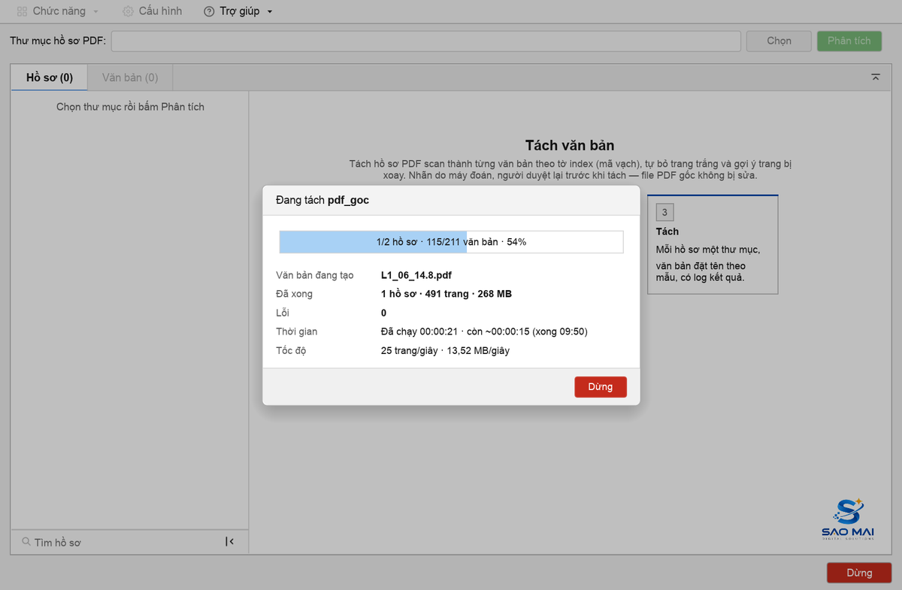

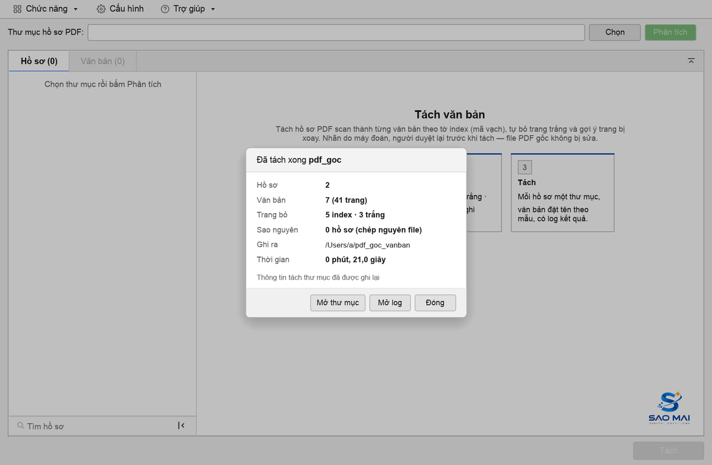

Lỗi được bắt và báo theo từng hồ sơ, không chặn hồ sơ khác: PDF có mật khẩu, file hỏng / không phải PDF, nhãn vượt số trang, không có quyền ghi, ổ đĩa đầy, đường dẫn quá dài (Windows). Hồ sơ không mở được hiện tên đỏ ở cột trái (di chuột để xem lý do).

### Dữ liệu của app

Nhãn, góc xoay, cache phân tích và log **không ghi vào thư mục đầu vào** mà nằm trong thư mục ẩn cạnh file chạy: `<thư mục chứa dema4_saomai>/.sm-dema4/<tên thư mục>-<mã>/`. Mỗi thư mục đầu vào một thư mục con riêng (file `thu_muc_goc.txt` ghi đường dẫn gốc), nên mở nhiều thư mục không lẫn nhau. Thư mục chứa app không ghi được → `%APPDATA%\sm-dema4\` (macOS `~/Library/Application Support/sm-dema4/`). Dữ liệu bản cũ trong `<thư mục đầu vào>/.sm-dema4/` được tự chuyển sang lần mở đầu tiên. Nút **Xoá cache** trong Cấu hình xoá kết quả phân tích của thư mục đang mở (nhãn giữ nguyên).

- `index_and_blank.txt` — 1 dòng/trang có nhãn, trang đếm từ 1 (định dạng cũ, script Python dùng tiếp được):
  ```
  HOP 462/4766/4766.pdf;10;index
  HOP 462/4766/4766.pdf;53;blank
  HOP 462/4766/4766.pdf;70;split
  ```
- `xoay_trang.txt` — góc xoay thêm theo chiều kim đồng hồ khi tách; `;xac_nhan` = trang Nghi xoay đã được người duyệt xác nhận (0° = đề xuất sai, giữ nguyên):
  ```
  HOP 462/4766/4766.pdf;24;180
  HOP 462/4766/4766.pdf;31;0;xac_nhan
  ```
- `ketqua_tach.txt` — log tách (tab): STT · file đầu vào · dải trang · file đầu ra · trang trắng đã bỏ · số trang; các dòng `#` cuối: file cũ không xoá được, `# Lỗi …` từng hồ sơ, `# Cảnh báo …` (dải chỉ có trang trắng, hồ sơ 0 trang).

### Dòng lệnh

```
dema4_saomai --tach <thư mục pdf> [--nhan <index_and_blank.txt>] [--ra <thư mục cha>]
```

Không có file nhãn → tự phân tích (Cấu hình mặc định), ghi `index_and_blank.txt` rồi tách. Mã thoát: 0 xong, 1 có hồ sơ lỗi, 2 sai tham số.

## Sinh mục lục hồ sơ

Menu **Chức năng › Sinh mục lục** (chi tiết trong **Trợ giúp › Hướng dẫn sử dụng**, F1).

1. **File biên mục**: Excel (.xlsx .xlsb .xls) hoặc CSV, mỗi văn bản một dòng, các dòng cùng hồ sơ nằm liền nhau; chọn sheet trong ô **Chọn sheet** và **Dòng tiêu đề** (số dòng như Excel hiển thị). Nút ⌄ cuối dòng xổ ra 10 dòng đầu của sheet kèm số dòng; dòng tô nền là Dòng tiêu đề, dữ liệu lấy từ dòng ngay sau. Nút ⓧ cuối ô đường dẫn bỏ file đã chọn.
2. **Mẫu mục lục** (bắt buộc tự chọn, chọn xong mở tab **Mẫu**): 4 mẫu có sẵn (Quảng Trị, Quảng Ninh, Đống Đa, Vĩnh Phúc) hoặc mẫu DOCX riêng của đơn vị; biến viết dạng `{ten_bien}`, hàng có nhiều biến nhất trong bảng là hàng mẫu (mỗi văn bản một hàng).
3. Tab **Mẫu**: biến tự khớp với cột cùng tên (bỏ dấu, không phân biệt hoa thường); bấm ô **Lấy từ** để chọn cột khác hoặc gõ giá trị cố định. **Nhóm theo** (chân sidebar) = cột tách hồ sơ, kèm số giá trị khác nhau của từng cột. Rê chuột lên dòng biến để thấy vị trí trên trang mẫu; hộp **Ghép biến…** sửa nhiều biến cùng lúc, kèm giá trị của hồ sơ đang xem.
4. Tab **Kết quả**: xem trước mục lục từng hồ sơ (bản mô phỏng chữ + bảng); hồ sơ có ô trống ở cột đã ghép được đánh dấu cảnh báo.
5. **Sinh mục lục** → mỗi hồ sơ một file DOCX, tên theo mẫu `MLHS_{so_ho_so}` (đổi ở **Cấu hình › Sinh mục lục**). Mặc định ghi vào thư mục ẩn `.sm-dema4/muc_luc/<tên file biên mục>` cạnh file chạy — mở bằng nút **Mở thư mục** trong popup kết quả.

Mỗi lần mở app hoặc chuyển sang chức năng này, màn hình bắt đầu trống (không nạp lại file / mẫu cũ); cách ghép biến đã chỉnh được nhớ và áp lại khi chọn đúng mẫu đó. Nút ⓧ cuối ô mẫu bỏ mẫu đang chọn. Xuất PDF (qua Word / LibreOffice) có ở bản sau.

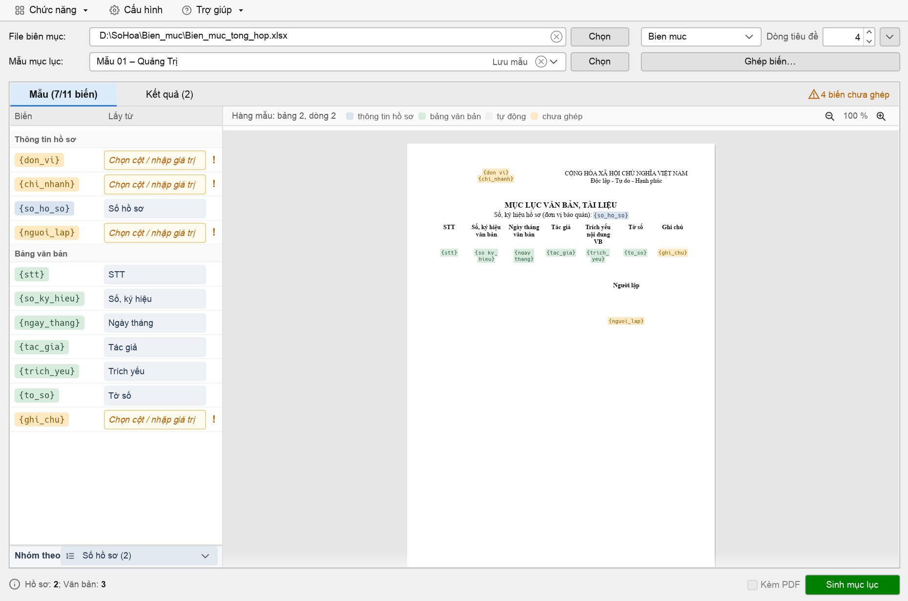

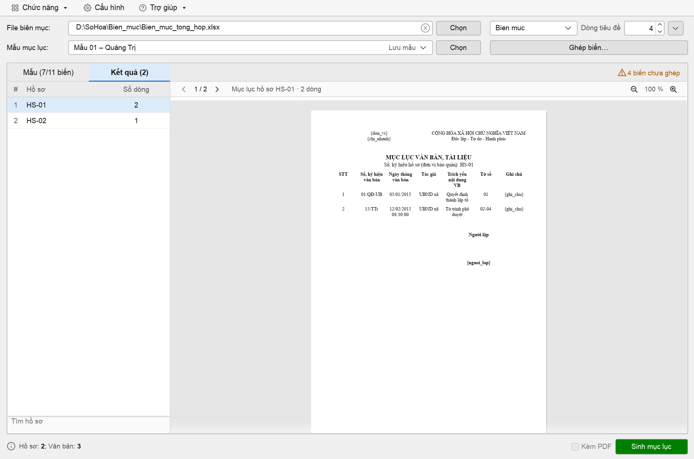

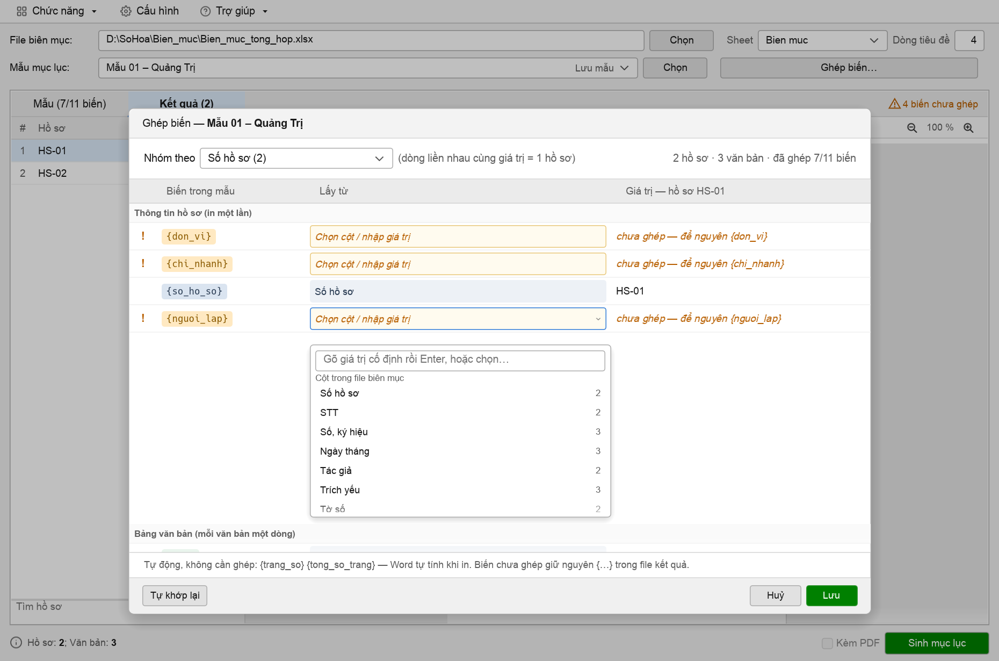

## Cấu hình (`.dema4_saomai.cfg`)

Menu **Cấu hình** (3 tab Đếm trang A4 / Tách PDF / Sinh mục lục) ghi file **ẩn** `.dema4_saomai.cfg` cạnh file chạy (không ghi được → thư mục người dùng như trên). Thiếu khoá / sai → giá trị mặc định. File tên cũ `sm-dema4.cfg` vẫn được đọc và tự chuyển sang tên mới ở lần lưu đầu tiên.

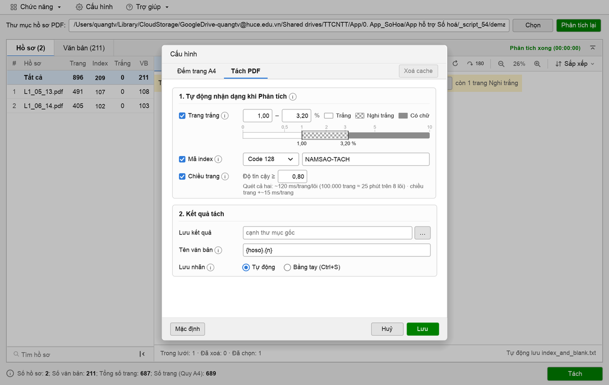

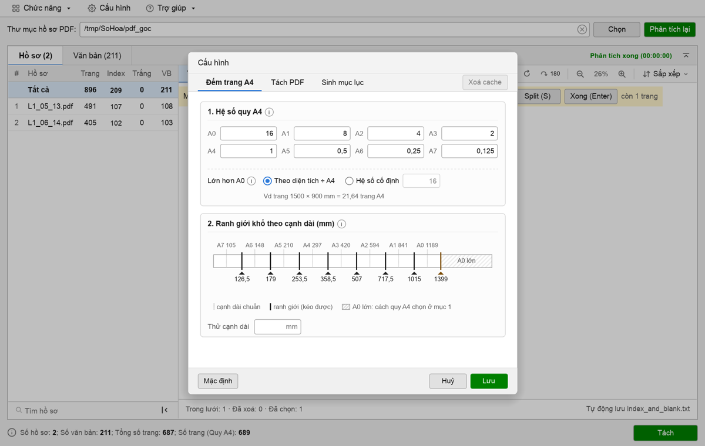

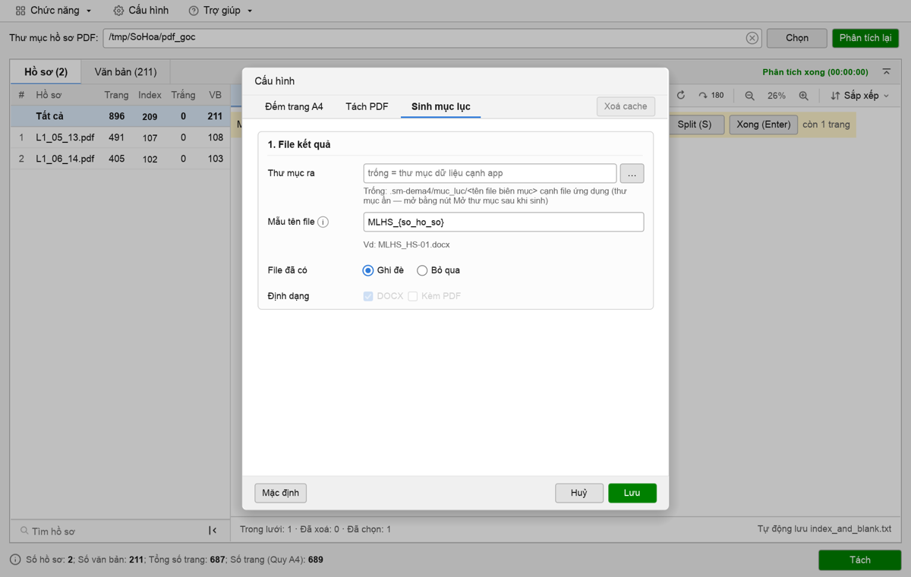

| Khoá | Mặc định | Ý nghĩa |
|---|---|---|
| `he_so_a0` … `he_so_a7` | 16 · 8 · 4 · 2 · 1 · 0,5 · 0,25 · 0,125 | hệ số quy A4 |
| `ranh_gioi` | 1015;717.5;507;358.5;253.5;179;126.5 | ranh giới khổ theo cạnh dài (mm); khác mặc định thì ghi vào `_dem.txt` |
| `a0_lon` · `a0_lon_he_so` · `a0_nguong_mm` | `dien_tich` · 16 · 1399 | trang A0 dài hơn ngưỡng: theo diện tích ÷ A4 hoặc hệ số cố định |
| `quet_trang` · `quet_ma` · `quet_xoay` | 1 · 1 · 1 | loại nhận dạng tự động khi Phân tích |
| `nguong_trang` · `nguong_nghi` | 1.00 · 3.20 | ngưỡng Trắng / Nghi trắng (% diện tích có nét mực đậm) |
| `loai_ma` · `ma_index` | `code128` · `NAMSAO-TACH` | mã tờ index (lệch ≤ 3 ký tự; trống = mọi mã) |
| `tin_cay_xoay` | 0.80 | độ tin cậy gợi ý Nghi xoay (0,50–0,95) |
| `thu_muc_ra` · `mau_ten` · `luu_nhan` | trống · `{hoso}.{n}` · `tu_dong` | thư mục cha kết quả; mẫu tên (`{hoso}` · `{n}` · `{n3}`…`{n9}` đệm số 0, vd `{n7}` → 0000001); lưu nhãn tự động / `bang_tay` |
| `rong_cot_trai` · `nac_anh_hs` · `nac_anh_vb` · `ty_le_vb` · `che_do_vb` · `an_dong_thu_muc` | 290 · 3 · 3 · 100 · `luoi` · 0 | trạng thái giao diện (nấc ảnh lưới 0–11: 3 = 26 %, 11 = 250 %) |

## Chế độ dòng lệnh (Đếm)

```
dema4_saomai <thư mục>             # đếm, ghi <thư mục>/<tên>_dem.txt và _dem_chitiet.txt
dema4_saomai <thư mục> --dpi       # kiểm tra DPI ảnh scan (chậm hơn)
dema4_saomai <thư mục> --kyso      # kiểm tra file đã ký số (AcroForm) hay chưa
dema4_saomai <thư mục> --khong-ghi # chỉ in kết quả, không ghi file, không gửi thống kê
```

Hệ số và ranh giới khổ đọc từ `.dema4_saomai.cfg` (không có file → mặc định).

## Ký văn bản

Đang phát triển: ký số hàng loạt văn bản đã tách bằng chứng thư của đơn vị. Hiện mới có màn giới thiệu.

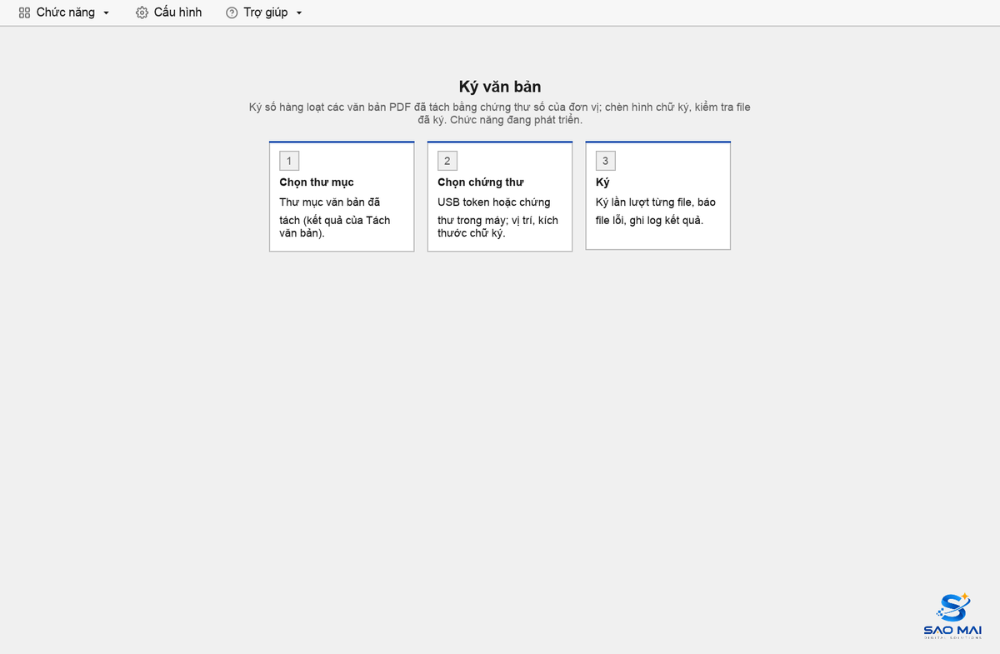

## Trợ giúp

**Trợ giúp › Hướng dẫn sử dụng** (F1) mở đúng tab của màn đang dùng; **Thông tin** có phiên bản, website và giấy phép thành phần; **Kiểm tra cập nhật** so với bản phát hành mới nhất trên GitHub.

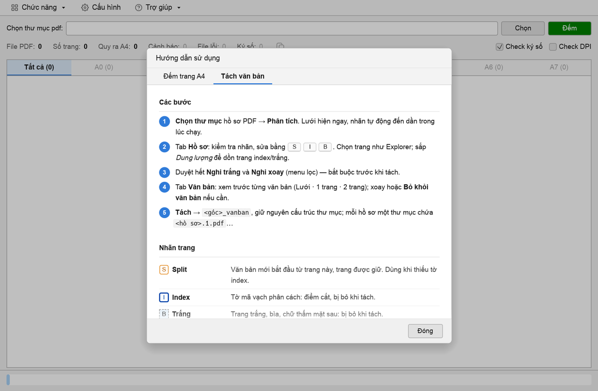

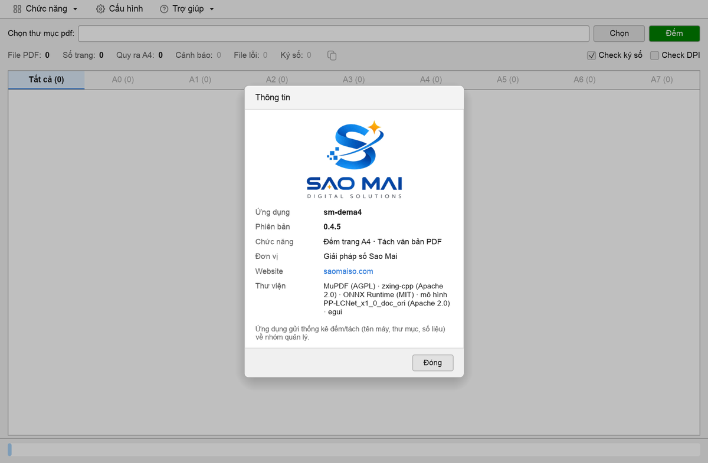

## Lượt dùng (license)

- Mỗi máy có **một hạn mức chung** (dùng thử **10 lần**): mỗi lần Đếm, Tách hay Sinh mục lục đều tính 1 lượt. Chỉ lần chạy **có kết quả** mới bị tính (kể cả khi bấm Dừng); không ra kết quả thì hoàn lượt. Áp dụng cho cả giao diện và dòng lệnh (hết lượt: in lý do + mã máy, mã thoát `3`).
- Nhóm Telegram nhận thông báo khi có **máy mới đăng ký**, sau mỗi lần **Đếm / Tách / Sinh mục lục**, và khi máy **hết lượt** (mỗi loại một mẫu tin riêng).
- Hết lượt → popup **Liên hệ Sao Mai** (mã máy, điện thoại **0979824615**, email **hotro@saomaiso.com**, saomaiso.com). Sao Mai cấp thêm lượt trên Sheet → bấm **Kiểm tra lại**.
- **Mã máy** `SM-XXXX-XXXX-XXXX` lấy từ ID hệ điều hành (không đổi khi đổi tên máy), xem ở **Trợ giúp › Thông tin**.
- Bấm Đếm / Tách quyết định ngay, không chờ mạng. Mất mạng: chạy được tối đa 2 lần chưa được máy chủ xác nhận, có mạng lại app tự ghi bù. Bị **Khoá** thì mất mạng vẫn khoá.
- Máy chủ là trạm Google Apps Script (`dema4_rs/apps-script/`) ghi tab `1_license` (mỗi máy 1 dòng: cột **Đã dùng** cộng dồn mọi chức năng, cột **Hạn mức** là tổng số lần được phép); câu trả lời có chữ ký RSA, app chỉ giữ khoá công khai. Cấp lượt: tab `1_license` → sửa **Hạn mức** (tổng mới) + Trạng thái **Đã cấp** (hướng dẫn ở ghi chú ô A1, ý nghĩa cột ở ghi chú từng ô tiêu đề).

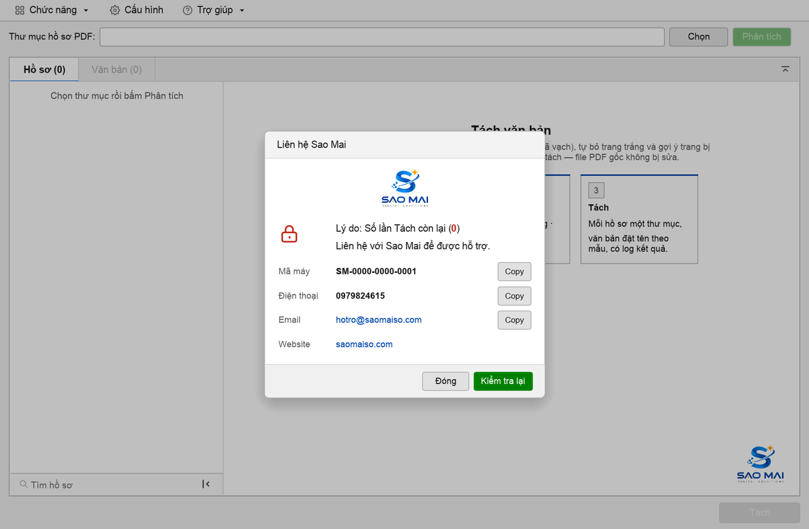

## Gửi thống kê

Sau mỗi lần đếm / tách / sinh mục lục xong, app gửi thống kê (mã máy, tên máy, địa chỉ MAC, IP nội bộ và IP public, thư mục hoặc đường dẫn file biên mục, số liệu — không gửi nội dung PDF hay nội dung biên mục) và báo công khai trong popup "Thông tin … đã được ghi lại".

App gửi số liệu tới **trạm license** (Google Apps Script gắn vào Sheet "Monitor_dema4", mã nguồn `dema4_rs/apps-script/`); app không giữ token Telegram hay khoá ghi Sheet. Trạm:

- soạn tin và gửi nhóm Telegram qua hàng đợi (tab ẩn `3_hang_doi_telegram`; token, id nhóm nằm trong Script Properties của trạm, không có trên Sheet). Lần tách gửi thêm 2 dòng thống kê ngưỡng trắng và file CSV histogram (dùng để chỉnh ngưỡng mặc định: `dema4_rs/scripts/tong-hop-nguong.py`);
- ghi tab `2_nguong_trang` (mỗi lần Tách 1 hàng; ý nghĩa cột ở ghi chú ô tiêu đề; dữ liệu tab cũ `nguong` của v0.5.x đã gộp vào đây). IP public lấy từ api.ipify.org.

Triển khai trạm: xem `dema4_rs/apps-script/README.md`; URL trạm đặt ở `URL_TRAM` (`dema4_rs/src/tram.rs`), khoá công khai ở `dema4_rs/assets/license_pub.pem`. Chưa có trạm thì app không gửi gì.

## Build từ mã nguồn

Cần Rust (rustup). Trên Windows cần thêm Visual Studio Build Tools (C++) và LLVM (bindgen cho MuPDF).

```
cd dema4_rs
cargo build --release
```

File chạy: `dema4_rs/target/release/dema4_saomai` (Windows: `dema4_saomai.exe`) — một file duy nhất, ONNX Runtime liên kết tĩnh, mô hình hướng trang nhúng sẵn.

GitHub Actions tự build cho macOS (arm64) và Windows (x64) mỗi khi push lên `main`; tạo tag `vX.Y.Z` để sinh Release kèm file chạy.

Ảnh chụp màn hình trong `docs/anh/` sinh từ các test kittest: `DEMA4_MAU_TACH=<thư mục mẫu> DEMA4_ANH=<thư mục ảnh> cargo test --release -- --ignored chup_man_dem` (và `chup_man_tach`, `chup_hop`, `chup_dang_phan_tich`).

## Giấy phép thành phần

MuPDF (AGPL) · zxing-cpp (Apache 2.0) · ONNX Runtime (MIT) · mô hình PP-LCNet_x1_0_doc_ori của PaddleOCR (Apache 2.0, xem `dema4_rs/assets/NOTICE-doc_ori.txt`) · egui (MIT / Apache 2.0).
